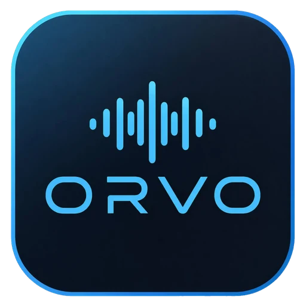
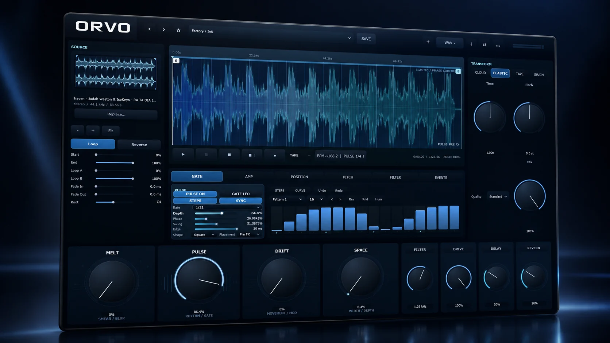

# ORVO

**Sound, transformed.** Import a sample. Stretch it, pitch it, freeze it, granulate it or warp it like tape. Cut it into rhythm with PULSE, then drag the result straight into your DAW.

### [Open the page](https://jesaias1.github.io/ORVO/) &nbsp;|&nbsp; [Download for Windows](https://github.com/jesaias1/ORVO/releases/latest)

**4** engines: Cloud, Elastic, Tape, Grain / **16** step PULSE gate, drawn by hand / **4** macros: Melt, Pulse, Drift, Space / **120** factory presets in 1.0

## What it does

- **Cloud.** Spectral time-stretch and pitch that turns any sample into a sustained, evolving texture.
- **Elastic.** Phase-coherent stretching that keeps the shape of the sound while time and pitch move independently.
- **Tape.** Speed and pitch move together, with the stop, drag and warp of a tape machine.
- **Grain.** A particle engine with size, density, position and spray, plus a one-button freeze.
- **PULSE.** A rhythmic gate with steps, rate, depth, swing and edge. Draw 16 steps by hand and sync them to the host tempo.
- **Four macros.** MELT smears, PULSE gates, DRIFT moves and SPACE widens, with filter, drive, delay and reverb beside them.
- **Drag it out as WAV.** Render the result and drag it into your DAW. Choose full length, a selection, a target time or bars, with fades and a bounded tail.
- **Bring anything in.** Import WAV, AIFF, FLAC or MP3 and set start, end, loop points, fades and root note.

## Requirements

- Windows 10 or 11, 64-bit
- A DAW that loads VST3 instruments (for the plugin)
- The standalone app runs on its own
- Uses JUCE 8 (see the third-party licences in the installer)

## Closed source

This repository holds the product page and download links only. The source code is not published.
&copy; 2026 Linas Jesaias. All rights reserved. See [LICENSE](LICENSE). The released binaries may be downloaded and used to make music.
